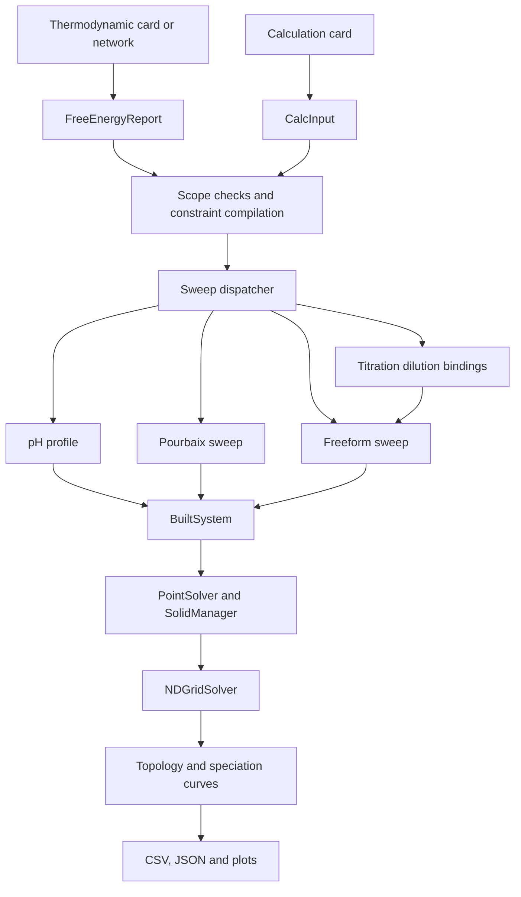

# Numerical pipeline architecture

The numerical pipeline adapts explicit cards into a shared solver system, evaluates a grid, extracts topology and writes scientific exports. Model agents build and interpret cards outside this deterministic calculation layer.

## Input and dispatch

`SRD46_numcalculator_api.run_calculation` resolves the thermodynamic card and parses the calculation card. It binds declared conditions and totals, validates scope, compiles constraints and calls the sweep dispatcher. The supported methods are `pH_sweep`, `pourbaix_sweep`, `freeform_sweep` and `titration_sweep`.

The input readers are in `numcalc_input_cards_reader`. All required axes, physical conditions, totals and model choices must be declared. There is no default-axis table or automatic conversion of incomplete legacy cards. Species pins are opt-in constraints checked by the native compiler; they are not initial guesses.

## Shared numerical state

`FreeEnergyReport` contains species, reaction and component thermodynamics. `BuiltSystem` projects those data into numerical arrays for mass balance, aqueous equilibrium, dissolution and redox calculations. A redox-enabled pH-only sweep requires an explicit fixed potential. A redox-excluded sweep keeps the declared oxidation states independent and has no potential coordinate.

`PointSolver` solves the aqueous equations. `SolidManager` manages active solid phases, precipitated amounts and ionic-strength iteration. A compatible neighbouring solution can initialize all these components. Donor preparation has its own bounded deadline before the normal ten-second point phase-search deadline begins. Recovery paths retain their configured time multipliers and convergence checks.

`NDGridSolver` performs coarse solving, neighbour continuation, retries and requested refinement. Refined boundaries and junctions derive from the final effective label field. Unconverged samples retain their status. Numerical recovery and topology processing serve different purposes and do not establish convergence by visual interpolation.

## Method and output ownership

| Location | Responsibility |
|---|---|
| `sweep_pipelines/_sweep_input_entry_point` | Dispatcher and shared input handling |
| `sweep_pipelines/pH_sweep` | One-dimensional speciation and curve assembly |
| `sweep_pipelines/pourbaix_sweep` | Potential/pH and optional water-activity sweeps |
| `sweep_pipelines/freeform_sweep` | Explicit scalar/composition axes |
| `sweep_pipelines/titration_sweep` | Fixed-pH dilution bindings passed to freeform |
| `solvers_and_topology/nd_grid` | Grid execution, continuation and refinement |
| `solvers_and_topology/_output_topology_mapper` | Predominance regions, boundaries and junctions |
| `sweep_pipelines/_output_and_plotting` | Scientific files and figures |

The API returns the handler result with resolved inputs and output location. `output_paths` is the authoritative file list. Native output writers handle long paths and may compact chemical-name stems. Speciation plots shade unconverged intervals grey; convergence columns remain available in numerical exports.

## Entry points and checks

See [API_AND_SETTINGS.md](API_AND_SETTINGS.md) for signatures, accepted input forms and per-method result keys. From the repository root, `python scripts/run_analysis.py --check` and `python run_browser.py --check` inspect installation without launching a solver or model. A calculation from saved cards is shown in the [README](README.md).
