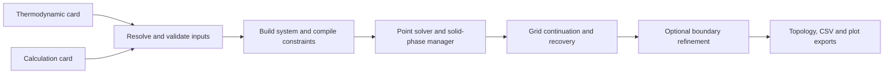

# SRD-46 numerical calculation pipeline

This package performs deterministic equilibrium calculations from saved thermodynamic and calculation cards. It supports pH speciation profiles, Pourbaix diagrams, freeform sweeps and fixed-pH titration/dilution scans.

## Run from saved cards

The following example assumes the caller has two validated LC2/LC3 card files and has installed the repository requirements. Replace the input paths with those from the intended analysis run:

```python
import sys
from pathlib import Path

sys.path.insert(0, str(Path("SRD46_research_agent").absolute()))
from NIST_SRD46_db_agent.NIST_SRD46_analysis_agent.NIST_SRD46_core_numcalc_pipeline.SRD46_numcalculator_api import run_calculation

result = run_calculation(
    card_source="path/to/free_energy_card_numcalc.md",
    calc_input="path/to/calc_input_card.json",
    output_dir="_output/calculation_example",
)
print(result["output_paths"])
```

This executes a solver. For installation checks without a calculation, use `python scripts/run_analysis.py --check` from the repository root.

## Inputs

The thermodynamic card defines species, reactions and free-energy information. The calculation card defines the system catalog, axes, conditions, totals, model choices and refinement. Required fields must be explicit; missing axes and physical declarations fail validation rather than acquiring numerical defaults. The two inputs are checked for compatibility before dispatch.

See [API_AND_SETTINGS.md](API_AND_SETTINGS.md) for accepted forms, constraints, settings and result keys. Use saved native cards as examples; incomplete JSON fragments are not runnable cards.

## Execution path



The methods share the numerical solver and grid infrastructure. Compatible neighbour states include aqueous and solid components. The normal point phase-search budget is ten seconds, separate from the bounded donor preparation. Numerical recovery solves points again; it does not convert unverified values into converged observations.

## Packages

| Package | Responsibility |
|---|---|
| `numcalc_input_cards_reader` | Card resolution and calculation-input validation |
| `thermodynamics_helpers` | Thermodynamic network and activity calculations |
| `solvers_and_topology` | Point solving, solids, grids, retries, refinement and topology |
| `sweep_pipelines` | Method dispatch and sweep assembly |
| `sweep_pipelines/_output_and_plotting` | CSV, JSON, topology and plot exports |

Nernst post-calculation tools live in [NIST_SRD46_post_calc_tools](../NIST_SRD46_post_calc_tools/README.md). They use their own entry points.
