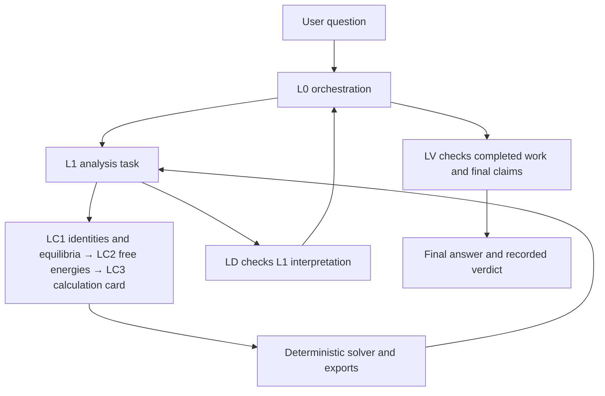

# SRD-46 Analysis agent

The Analysis agent answers questions about speciation, chelation, redox behaviour and related equilibrium calculations. LLM agents select chemical systems, construct calculation cards and interpret results. The numerical solver performs equilibrium calculations. Optional Query-assisted estimation supplies explicitly identified missing-equilibrium inputs.

## Running

Use `python scripts/run_analysis.py --guide` from the repository root for benchmark selection, model/provider settings and output controls. `scripts/run_ff1.py` uses the same configuration with a freeform Markdown prompt. These launchers create fresh runs and reject output collisions.

The native Python API is:

```python
from NIST_SRD46_db_agent.NIST_SRD46_analysis_agent import SRD46_analysis_run

result = SRD46_analysis_run(
    "Pourbaix diagram of Cu in glycine",
    session_dir="_output/example_run",
    debug=False,
)
print(result["answer"])
```

For direct Python use, make `SRD46_research_agent` importable and apply the intended configuration. `SRD46_analysis_argo_config.py` defines native defaults; standalone settings and launcher flags can override them. Native L0, L1, LD and LV models default to `claudeopus47`. Provider reasoning/thinking overrides are omitted unless explicitly configured.

## Agent and calculation flow



L0 dispatches L1 tasks and synthesizes their reports. L1 builds cards, invokes the solver and commits its interpretation with `record_analysis`. LD checks that interpretation against outputs. Contradicted reports trigger bounded revision; estimation-enabled runs also revise inconclusive reports.

LV checks whether the required work was performed and whether the final claims fit the question, chemical system, pipeline capabilities and evidence. Execution failures return to L0 within a separate bounded continuation budget. Other verdicts remain recorded in the manifest. Deterministic screening applies unless LV explicitly waives an applicable check with a reason.

LD and LV are enabled by default. `LV_WRITE_ARTIFACTS=False` suppresses the separate LV folder; it does not disable LV or remove its manifest/history records. The final answer is L0's synthesis, with timeout or incomplete-validation notices when applicable.

## Packages

| Package | Responsibility |
|---|---|
| `analysis_agent_orchestration` | L0, L1, LD and LV conversations and runtime prompts |
| `analysis_agent_argo_engine` | Tier-specific clients and budgets |
| `analysis_agent_context_hooks` | Working memory, history, statistics and completion verdicts |
| `analysis_agent_toolbox` | Tool catalogs and native calculation wrappers |
| `NIST_SRD46_calc_input_building_agentic_pipeline` | LC1–LC3 card building |
| `NIST_SRD46_core_numcalc_pipeline` | Numerical solving, topology and export |
| `NIST_SRD46_normalizer_helpers` | Chemical identities and constraint normalization |
| `NIST_SRD46_post_calc_tools` | Post-calculation tools |

Catalog-visible species values are not numerical warm-start guesses. At the numerical API, species pins require explicit permission in constraint settings and compatible native constraints, checked against the thermodynamic report.

## Session files

| File or folder | Content |
|---|---|
| `answer.md` | L0 synthesis and applicable execution/validation notices |
| `run_history.md`, `run_history.jsonl` | Execution events and tool history |
| `manifest.json`, `run_stats.json` | Dispatch/validation state and phase statistics |
| `working_memory.json` | Native session working memory |
| `verdict.json` | Manifest completion summary with applicable LV outcome |
| `L1_call_NN/` | Task input, LC1/LC2/LC3 cards, solver outputs, pipeline status, committed L1 report and LD review |
| `l0_tool_calls.md`, `final_full_context.md` | L0 tool trace and saved final context |
| `run_provenance/` | Native request/response and reconstruction evidence |
| `LV/` | Separate LV artifacts only when enabled for writing |

Estimation-enabled runs also retain scientific-quality and materialization evidence in their L1 task folders. Only intact native ledgers with the required boundary and context records can support first-principle reconstruction. See the [reconstruction guide](../general_db_query_engine/general_first_principle_API_call_reconstruct/README.md). Published anonymized traces are inspection copies, not exact-replay sources.
