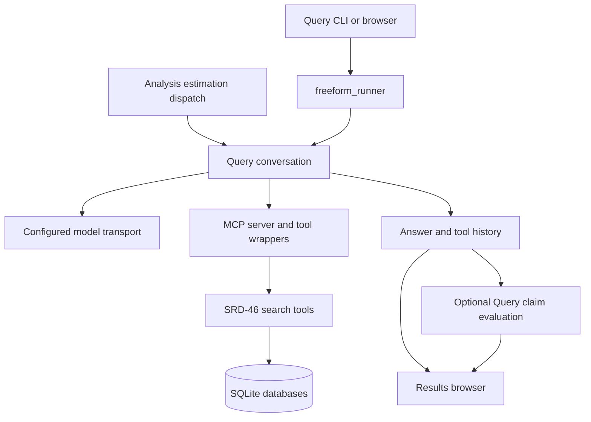

# Query runtime architecture

The Query package connects a model conversation to read-only SRD-46 tools and records its answer and tool history. The standalone browser and Analysis estimation dispatch use this runtime through their respective native entry points.

## Conversation and tools

`query_agent.py` owns the Query loop. `argo_client.py` and `argo_config.py` supply native transport settings; standalone configuration binds the selected provider and model. `server.py` registers tools, while `SRD46_tools` normalizes arguments and supplies planning/compaction helpers. The underlying implementations are in the sibling `NIST_SRD46_core_db_search_tools` package.

Standalone Query discovery resolves identities and catalogs before search planning and evidence retrieval. Embedded estimation uses the context and follow-up policy supplied by the Analysis pipeline. Tool returns and model messages remain distinct in saved histories. Optional claim evaluation operates on recorded outputs; it does not supply solver results.

## Entry points and ownership

| File/package | Responsibility |
|---|---|
| `API_SRD46_Query_UI.py` | Package Query/browser CLI |
| `freeform_runner.py` | Single-question execution and raw/evaluation output paths |
| `agent_runtime.py`, `terminal_chat.py` | Interactive terminal sessions |
| `main.py`, `server.py` | MCP server |
| `BATCH_run_scripts` | Query benchmark execution and evaluation wrappers |
| `SRD46_query_output_eval_pipeline` | Claim extraction, grounding and statistics |
| `../../NIST_SRD46_database_browser` | Browser routes, archive access and launch forms |

The publication root launcher is `python run_browser.py`. It applies standalone settings and restores required assets before serving the UI. The browser reserves one shared Query/Analysis run slot; separate worker processes are required for independent concurrent sessions.

## Storage

New Query raw outputs use `<output_root>/Query/_output`; extracted/evaluated outputs use `<output_root>/Query/_output_eval`. The root defaults to `_output`. Published examples live under `_benchmark` or indexed output ZIPs. Database packs and output archives have separate manifests and purposes.

The browser reads unpacked files first and archived members when loose files are absent. Query claim annotations and Analysis excerpt labels use their own native formats. Runtime ledgers support exact reconstruction only when their context and integrity records remain intact; anonymized published traces are inspection copies.

See the [Query guide](README.md), [tool reference](SRD46_tools/TOOLS_REFERENCE.md), [browser guide](../../NIST_SRD46_database_browser/README.md) and [database guide](../../NIST_SRD46_core_db_storage/README.md).
